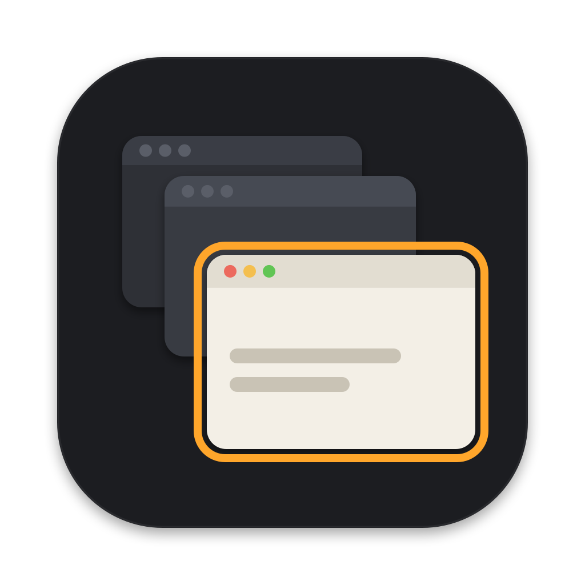

<p align="center">
  
</p>

<h1 align="center">TabSwitch</h1>

<p align="center">
  A fast, private, Windows-style window switcher for macOS.<br>
  Hold <kbd>⌥</kbd> and press <kbd>⇥</kbd> to see every window, not just every app.
</p>

<p align="center">
  <a href="../../releases/latest"><b>Download</b></a> ·
  <a href="#install">Install</a> ·
  <a href="#keyboard">Keyboard</a> ·
  <a href="#privacy--security">Privacy</a> ·
  <a href="#build-from-source">Build from source</a>
</p>

---

macOS <kbd>⌘</kbd><kbd>⇥</kbd> switches between **apps**. If you have three Chrome windows, you can't pick the one you want. TabSwitch shows **each window** with a live preview, so you can go straight to it.

- **Native and small:** about 700 lines of Swift, no third-party code, no Electron.
- **Free:** every feature is included. No license key, no trial.
- **Private:** no network access, no telemetry, no analytics. Details under [Privacy & Security](#privacy--security).

## Features

| | |
|---|---|
| **Window switching** | All windows of all apps, most recently used first |
| **Three styles** | Live thumbnails, app icons, or a compact list of titles |
| **Search** | Type part of a window title or app name. Fuzzy matching: `gchr` finds *Google Chrome* |
| **Window actions** | Close, minimize, full screen, hide app or quit app from inside the switcher, using keys or hover buttons |
| **Minimized and hidden windows** | Shown with a badge, and restored when you pick them |
| **Current app only** | <kbd>⌥</kbd><kbd>`</kbd> shows only the windows of the app you're in |
| **Two modes** | Release the key to switch, or keep the switcher open and press <kbd>⏎</kbd> |
| **Quick tap** | A fast <kbd>⌥</kbd><kbd>⇥</kbd> jumps to the previous window without showing the switcher |
| **Replace ⌘⇥** | Optional: use <kbd>⌘</kbd> as the trigger instead of <kbd>⌥</kbd> or <kbd>⌃</kbd> |
| **Multiple displays** | Opens on the screen with the mouse. Can be set to show only that screen's windows |
| **Exceptions** | Hide apps such as VMs, remote desktops or noisy utilities |
| **Command line** | `TabSwitch list` and `TabSwitch focus <id>` for scripts |
| **Fits in** | Follows light and dark mode, translucent macOS material, works with VoiceOver |

## Install

1. Download `TabSwitch-x.y.z.zip` from the [latest release](../../releases/latest) and unzip it.
2. Move **TabSwitch.app** to **Applications**.
3. Open it. macOS will block it the first time, because the app isn't notarized by Apple (see [why](#why-does-macos-warn-me)).
   Go to **System Settings → Privacy & Security**, scroll down and click **Open Anyway**.
4. Grant two permissions when asked:

| Permission | Why it's needed |
|---|---|
| **Accessibility** | To list windows, react to the shortcut and bring the chosen window to the front |
| **Screen Recording** | Only to draw window thumbnails. Without it, TabSwitch still works and shows app icons instead |

5. Quit TabSwitch from its menu bar icon and open it again so both permissions take effect.

> **Coming from another switcher?** Quit it first. Two apps listening for <kbd>⌥</kbd><kbd>⇥</kbd> will fight over the shortcut.

## Keyboard

| Keys | Action |
|---|---|
| <kbd>⌥</kbd> + <kbd>⇥</kbd> | Open the switcher or move to the next window |
| <kbd>⌥</kbd> + <kbd>⇧</kbd><kbd>⇥</kbd> | Move to the previous window |
| <kbd>⌥</kbd> + <kbd>`</kbd> | Show only the current app's windows |
| Release <kbd>⌥</kbd> | Switch to the selected window |
| Arrow keys | Move around the grid |
| <kbd>⏎</kbd> or click | Switch |
| <kbd>esc</kbd> | Cancel |
| <kbd>⌥</kbd> + <kbd>S</kbd> | Search: keeps the switcher open while you type |
| <kbd>⌥</kbd> + <kbd>W</kbd> / <kbd>M</kbd> / <kbd>F</kbd> | Close / minimize / full screen the selected window |
| <kbd>⌥</kbd> + <kbd>H</kbd> / <kbd>Q</kbd> | Hide / quit the selected window's app |

<kbd>⌥</kbd> stands for whichever modifier you chose in Settings.

## Settings

Click the menu bar icon and choose **Settings…**. You can change:

- **Trigger key:** ⌥, ⌃ or ⌘.
- **Switching mode:** release to switch, or keep open.
- **Appear delay.**
- **Style and thumbnail size.**
- **Which windows to show.**
- **Exceptions.**
- **Launch at login.**

## Command line

```bash
alias tabswitch=/Applications/TabSwitch.app/Contents/MacOS/TabSwitch
tabswitch list            # <window-id>  <app>  <title>
tabswitch focus 12345     # bring that window to the front
```

The terminal app running these commands needs Accessibility permission too.

## Privacy & Security

TabSwitch needs strong permissions, so this section explains what it does with them.

- **No network access.** The source has no networking code at all: no updates, analytics or crash reporting. You can check with `grep -rn "URLSession\|http" Sources`.
- **No data stored**, apart from your settings in `~/Library/Preferences/com.sheraz.tabswitch.plist`.
- **Keystrokes:** the shortcut listener sees key presses. It only acts on keys while the switcher is open, or on the trigger shortcut itself. It never records or stores them.
- **Thumbnails** are captured with Apple's ScreenCaptureKit when the switcher opens. They are kept in memory only and never written to disk.
- **Hardened runtime** is enabled on the app bundle.
- **Verifiable builds:** releases are built by [GitHub Actions](.github/workflows/release.yml) from the tagged source, not on a personal machine. Each release includes a SHA-256 checksum and a signed [build provenance attestation](https://docs.github.com/en/actions/security-for-github-actions/using-artifact-attestations). Verify a download with:

```bash
shasum -a 256 -c TabSwitch-x.y.z.zip.sha256
gh attestation verify TabSwitch-x.y.z.zip --repo <owner>/<repo>
```

Two private macOS APIs are used, the same ones other window managers use:

| API | Purpose |
|---|---|
| `_AXUIElementGetWindow` | Matches an accessibility window to its window ID, for thumbnails and ordering |
| `CGSSetSymbolicHotKeyEnabled` | Only used if you choose ⌘ as the trigger: turns off the system ⌘⇥ switcher. It is turned back on when TabSwitch quits |

### Why does macOS warn me?

Apple notarization requires a paid Apple Developer account. TabSwitch is signed ad-hoc instead, so Gatekeeper asks once. If you'd rather not trust a binary at all, [build it yourself](#build-from-source). It takes about a minute.

## Build from source

You need macOS 14 or later and the Xcode Command Line Tools (`xcode-select --install`). Full Xcode is not required.

```bash
git clone https://github.com/<owner>/<repo>.git && cd <repo>
./build.sh            # -> build/TabSwitch.app
./build.sh install    # build, copy to /Applications, launch
./build.sh release    # build + zip + sha256
swift build && .build/debug/TabSwitch selftest
```

Rebuilding changes the ad-hoc signature, so macOS forgets the permissions. After each rebuild, remove TabSwitch from **Accessibility** and **Screen Recording** and add it again.

The icon is drawn in code: `swift scripts/make-icon.swift Resources/icon-1024.png`.

## Known limitations

- Only windows on the **current Space** are listed. Minimized windows and windows of hidden apps are listed too.
- Action keys such as <kbd>W</kbd> and <kbd>M</kbd> use physical key positions, so on non-QWERTY layouts the letter may differ.
- If TabSwitch crashes while set to <kbd>⌘</kbd>, the system <kbd>⌘</kbd><kbd>⇥</kbd> stays off until you open TabSwitch again or log out.

## Release a new version (maintainers)

```bash
git tag v1.0.0 && git push origin v1.0.0
```

GitHub Actions builds the app, runs the self-test, attests the zip and publishes the release.

## License

[MIT](LICENSE) © 2026 Sheraz Saqib

TabSwitch is an independent project. It is not affiliated with or derived from AltTab or any other window switcher.
